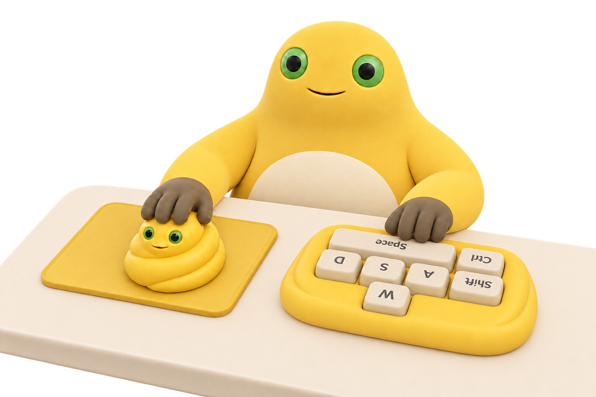

# MilkFrog DesktopPet 奶蛙桌宠

Windows 10/11 x64 奶蛙桌宠。**主版本使用 Rust + 原生 Win32 窗口，发行版不包含 Electron、WebView、Node.js 或输入助手。**



## 使用

**下载 Windows x64：**[安装版](https://github.com/aurooooooo/MilkFrog-DesktopPet/releases/latest/download/MilkFrog-0.4.1-rust-setup-x64.exe) · [免安装版](https://github.com/aurooooooo/MilkFrog-DesktopPet/releases/latest/download/MilkFrog-0.4.1-rust-x64.exe) · [发布说明与校验文件](https://github.com/aurooooooo/MilkFrog-DesktopPet/releases/latest)

推荐运行 `dist/MilkFrog-0.4.1-rust-setup-x64.exe` 安装，可选择当前用户可写的安装位置，创建桌面与开始菜单快捷方式，并在 Windows 应用列表中提供卸载入口；无需管理员权限。

免安装使用 `dist/MilkFrog-0.4.1-rust-x64.exe`，开发目录可双击 `start.bat`。安装、升级或卸载前先从托盘退出正在运行的 Rust 奶蛙。所有图像、音效和动画已嵌入 EXE，无需复制素材文件夹或安装 Rust。

- A / W / S / D / 左 Shift / 左 Ctrl / 空格，支持按住、组合键和独立按下反馈；按键跟踪不播放音频。
- 沿用已确认的七键布局、手臂形状、鼠标方向和移动范围，眼珠与手臂平滑跟踪鼠标。
- 奶蛙右键：装扮、动作、大小。原生菜单不受奶蛙窗口大小裁切。
- 尺寸 15%～135%，默认 65%，常用比例和每次 5% 微调。
- 三种装扮；切换或取消形象时随机播放四条语音之一。“清除装扮”改为播放原来的按键音。
- 捧腹大笑：透明动画与笑声，结束恢复桌宠；再次选择、单击或 Esc 停止。
- 托盘右键：显示、隐藏、装扮、动作、大小、静音、自启动、游戏模式、退出。
- 游戏模式鼠标穿透、不抢焦点，仍允许音频；静音独立控制所有声音。
- 隐藏后停止输入轮询和媒体；静止时不重绘。单实例、离线运行、无需管理员权限。

自启动默认关闭，仅在用户切换开关时修改当前用户的 Windows Run 项。免安装版请先把 EXE 放在固定位置，移动后重新开启；从便携版换到安装版也需在安装后的程序中重新开启一次。不会在启动时自动恢复 Windows 禁用的项目。Rust 和旧版共用同一个启动项名称，明确开启 Rust 自启动时会将它更新为当前 Rust EXE 路径。安装版升级保留其已有启动项；卸载仅清理指向自身安装路径的启动项，保留个人设置。

Rust 设置与首次播放时解出的紧凑视频保存在 `%APPDATA%/MilkFrogRust/`。首次读取设置时可导入原 Electron 版本的大小、装扮、静音和游戏模式；不自动改写原版设置或启动项。

## 开发与构建

开发机需要 Rust stable（最低 1.86）、MSVC x64 构建工具和 Windows SDK。运行程序不需要这些工具。

```powershell
cargo fetch --manifest-path rust/Cargo.toml
.\scripts\rust.ps1 test
.\scripts\rust.ps1 clippy
.\scripts\build-rust.ps1
.\scripts\build-rust-installer.ps1
```

`scripts/rust.ps1` 优先兼容本工作区的 `.native-toolchain` 编译工具缓存；其他开发机正常安装 Visual Studio C++ Build Tools 即可。使用静态 CRT 链接，避免要求额外安装 VC++ 运行库。

构建结果为 `dist/MilkFrog-0.4.1-rust-x64.exe`（免安装）和 `dist/MilkFrog-0.4.1-rust-setup-x64.exe`（安装包），附带 SHA256 和第三方许可清单。安装包构建需要 NSIS 3，优先使用本工作区已有缓存或 PATH 中的 `makensis.exe`。内嵌资源已准备好，普通构建不需要 FFmpeg、Electron 或另一个仓库。

重做素材时才运行：

```powershell
node scripts/prepare-rust.cjs
```

该命令在构建时使用 FFmpeg 和原 Electron 绘制代码导出 PNG、肩部遮罩、PCM 音效以及颜色 / 透明度并排的 H.264 视频。原始图片、原视频与已有 Electron 运行素材保留不变。来源见 `rust/assets/SOURCES.md`。

## 检查与内存

```powershell
.\rust\target\release\milkfrog.exe --self-test
```

自检启动隐藏原生窗口，使用本程序内部的模拟输入，不向系统合成键鼠；验证装扮、原生菜单、尺寸、实际 Windows 音频设备、完整透明大笑播放和资源释放。音频测试静音，不改系统启动项，结果和截图写到当前工作目录的 `.test-artifacts/rust/`。

数据和验证边界见 [Rust 0.4.1 验证](design/0.4.1-rust验证.md)。内存随系统缩放、窗口大小、视频解码器和运行时长变化，短测不等于长期无泄漏。

## 实现

- Win32 分层透明窗口 + tiny-skia 软件绘制，位图与画布复用，只保留当前装扮。
- 主进程查询 `GetAsyncKeyState` 和 `GetCursorPos`，不启动输入子进程，不安装钩子或驱动。
- 原手臂分条变形、按键反馈、鼠标垫约束及运动参数已迁为 Rust，并与 JavaScript 几何样例逐项比较。
- 音频使用 Windows `waveOut`；播放结束回收设备和缓冲头，游戏模式不自动静音。
- 大笑使用 Windows Media Foundation 按帧解码；从并排颜色 / 透明度恢复透明画面，不预解码完整视频。结束 / 取消 / 隐藏时释放解码器。
- 不访问游戏进程、内存，不合成或拦截输入。鼠标仍读取系统光标，因此游戏锁定光标时不会产生真实相对位移。尚未做 Apex 联机验收。

Windows N 等缺少媒体组件的系统可能需要启用系统媒体功能。当前 EXE 未签名。

## Electron 历史版本

`src/`、`native/InputMonitor.cs` 和旧的 npm 构建仍保留作参考，**不进入 Rust 成品**。0.3.1 的开发 / 打包说明归档在 [Electron 0.3.1](design/Electron-0.3.1.md)。旧版可通过 `npm start` 开发运行；Rust 主版使用上面的 Cargo / PowerShell 命令。

## License

项目代码 MIT；第三方 Rust 库许可见 `rust/THIRD-PARTY-NOTICES.txt`，图片与音视频来源见相应 SOURCES 文件。[隐私说明](PRIVACY.md)。
